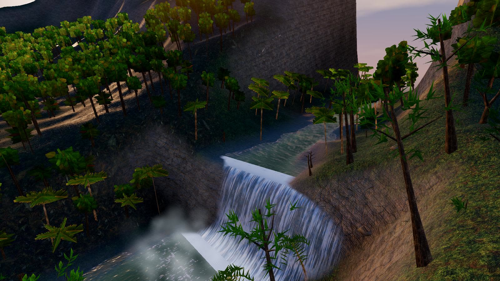
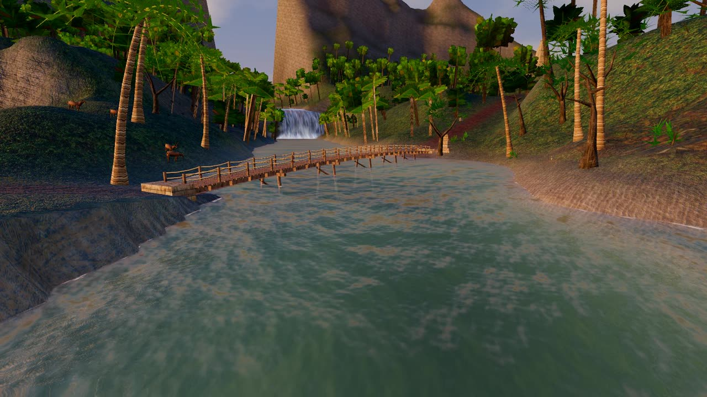
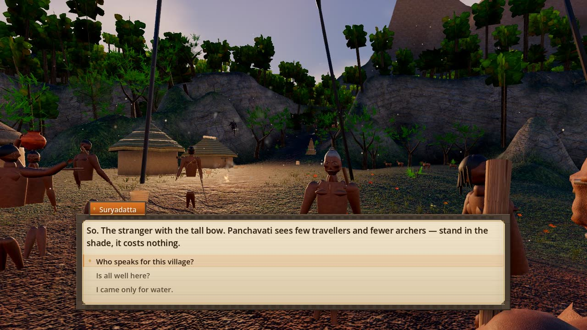

# RAMA — The Five Kandas of Dharma

An open-world action-adventure epic set in ancient India, chronicling the life and exile
of **Lord Rama** (*Suryavamsha Prince of Kosala*) across the **Five Kandas** of the
*Valmiki Ramayana*. Built in **Godot 4.7.2** (Forward+ / Metal), macOS only.

Almost everything in this project is generated. The textures, sound effects, ambience
and music are synthesised in Python (`tools/gen_*.py`); the terrain, water, trees,
buildings, sacred monuments, animals, rakshasas, iconography and divine weapons are
generated as meshes in GDScript.

Two things are licensed rather than generated: the humanoid base meshes for the human
characters (Rama, Sita, Lakshmana, sages, guards and villagers), from Quaternius's
*Ultimate Modular Men* and *Women* packs, and their animation clips, from Kay Lousberg's
*KayKit Character Animations*. Both are CC0 1.0. [assets/CREDITS.md](assets/CREDITS.md)
lists each file with its source, author and licence.

**Status (2026-11-13): release candidate, draft.** The quiet test gate (`tools/run_tests.sh`)
runs 20 suites and all 20 passed on the last full run, including the four that need a
renderer (they run off-screen on a Mac). The frame-time figures from that run were taken on a
development laptop that was in use (load average about 5), and they are CPU frame times (the GPU
column reads 0 off-screen), so treat them as indicative: mean 41 fps over six legs, worst leg
(deep wood) 38 fps, village 44 fps; the gate is 20 fps. CI runs the 16 headless suites on every
push. See [ROADMAP.md](ROADMAP.md) for what is next.

---

## Install

```bash
# 1. Godot 4.7.2 (any 4.7.x): set $GODOT, or put `godot` on PATH, or use ~/tools/Godot.app
# 2. Commit gate: gdlint on staged .gd files + the fast test suites (run_tests.sh --fast)
pip3 install "gdtoolkit==4.*"
git config core.hooksPath .githooks
# 3. Only if you regenerate textures or audio (tools/gen_*.py)
pip3 install numpy pillow
```

## Configure

There are no environment variables and no `.env`. Everything is in `project.godot`.
Graphics tiers (LOW/MEDIUM/HIGH/ULTRA) are chosen in the in-game settings menu. The
first launch bakes the world heightfield (~10 s) and caches it at `user://worldmap.cache`;
delete that file to force a re-bake.

## Run

```bash
~/tools/Godot.app/Contents/MacOS/Godot --path .     # from the repo root
tools/make_app.sh                                    # optional: ~/Desktop/RAMA.app launcher
```

## Controls

| input | action |
|---|---|
| `W A S D` / arrows / left stick | move |
| mouse / right stick | look |
| `Shift` | sprint (drains stamina) |
| `Space` | jump / swim upward |
| `Ctrl` | dodge roll (invulnerable through the roll) |
| `V` / `Z` | stealth crouch (halves enemy detection range) |
| **Right mouse (hold)** | draw the bow (*Kodanda*) — hold longer for more power (or parry in sword mode) |
| **Right mouse (release)** / **Left mouse (while aiming)** | loose arrow or invoked *Divya Astra* |
| **Left mouse** | melee attack (3-hit *Nandaka* sword combo with golden slash arcs) |
| `F` / Right Shoulder | **Kshatriya Parry** — deflect incoming strikes (`0.35s` window), restore Prana & Stamina, and empower a `2.0x` Counter-Strike |
| `1` – `5` / `R` | select or cycle **Divya Astra** (`1` *Shara*, `2` *Agneyastra*, `3` *Varunastra*, `4` *Vayavyastra*, `5` *Brahmastra*) |
| `H` | quick-heal using satchel herbs/salves/berries |
| `Q` | swap between *Kodanda* (bow) and *Nandaka* (sword) |
| `E` | interact / talk / use selected item in Satchel (`I`) |
| `J` | journal (Quests · Places · **The Five Kandas**) · `I` inventory satchel |
| `Esc` | pause · `F5` quick save · `F6` quick load |
| `F7` | developer screenshot |

## The Five Kandas & World

Across a 768 × 768 m hand-composed valley spanning the **Godavari**, **Panchavati**,
**Chitrakoot**, **Rishyamukha**, and the **Southern Causeway**:

1. **Bala Kanda — *The Bow of Shiva & The Sacred Fire***: Speak with **Brahmarshi Vishvamitra**, behold thebroken **Pinaka (Shiva Dhanush)** at Siddhashrama, and slay the forest demoness **Tataka** to receive the **Agneyastra** (*Celestial Arrow of Agni*).
2. **Ayodhya Kanda — *The Sandals of Dharma***: Meet **Prince Bharata** at the Godavari Ford, consecrate the **Golden Paduka Shrine**, and receive **Sita's** blessing at the **Tulsi Vrindavan** to attune the **Varunastra** (*Celestial Torrent of Varuna*).
3. **Aranya Kanda — *The Golden Deer & Jatayu's Vigil***: Investigate **Maricha's Golden Deer**, honor the fallen **Vulture-King Jatayu**, and defeat the Rakshasa general **Khara** to awaken the **Vayavyastra** (*Piercing Gale of Vayu*).
4. **Kishkindha Kanda — *Hanuman & The Seven Sala Trees***: Meet **Mahavira Hanuman** (wielding his golden *Gada*) on the Rishyamukha crag and pierce all seven trunks of the **Sapta Tala** with a single wind-infused arrow.
5. **Yuddha Kanda — *Aditya Hridayam & The Fall of Ravana***: Receive the **Akshaya Tunira** (inexhaustible quiver) and **Brahmastra** from **Sage Agastya**, chant the *Aditya Hridayam* at the **Surya Altar**, consecrate the floating **Rama Setu Stone**, and vanquishthe ten-headed **Dasagriva Ravana** and **Kumbhakarna** in the Southern Badlands.

In the current build the quests tell how Rama receives each Divya Astra but do not gate them: all five are selectable with `1` – `5` from the start, each costing its Prana (0, 18, 18, 20 and 40), and a shot with too little Prana falls back to the standard *Shara*.

Alongside the Five Kandas, the three village quests (**The Path Through the Forest**,
**The Forgotten Shrine**, and **Into the Wild**), 18 scheduled NPCs (12 villagers + 6
Ramayana companions), and 10 discoverable landmarks bring the valley to life.

## Test

```bash
tools/run_tests.sh                              # the full 19-suite gate; quiet: no window, no focus, no sound
tools/run_tests.sh --headless-only              # the 15 suites that need no renderer (what CI runs)
tools/run_tests.sh --fast                       # the seven few-second suites (the pre-commit hook)
tools/run_tests.sh quests ui                    # just these suites; logs in build/test-logs/
tools/gd.sh scene res://scenes/playtest.tscn    # drives the game, asserts movement + combat
tools/gd.sh scene res://scenes/asset_test.tscn  # every texture, sound and shader loads
tools/gd.sh test tests/bake_map_test.gd         # world sanity + top-down map render
tools/gd.sh test tests/terrain_test.gd          # meshing, LODs, triangle budget
```

Render harnesses write PNGs to `build/screenshots/` so results can be looked at rather
than assumed.

## Screenshots





Frames from the 2026-11-13 gameplay recording (`tests/probes/showcase.gd`, rendered off-screen
with Godot's movie writer). A short gameplay video is attached to the release.

## Download for macOS

The macOS build (a universal binary, unsigned release candidate; only the Apple Silicon half has been run) is attached to the
[Releases page](https://github.com/TeleVision05/RAMA/releases). It is ad-hoc signed, not
notarized, so macOS will refuse a plain double-click. Unzip it, then **right-click
`RAMA.app` and choose Open**, and confirm once; or run
`xattr -dr com.apple.quarantine RAMA.app`.

To build it yourself (export templates for 4.7.2 installed): `godot --headless --path .
--export-release "macOS" build/export/RAMA.app`, then `codesign --force --deep -s -
build/export/RAMA.app`. To check the result without opening a window:
`tools/run_tests.sh --exported build/export/RAMA.app`.

## License

Code: MIT, see [LICENSE](LICENSE). The CC0 character models and animations are
credited in [assets/CREDITS.md](assets/CREDITS.md).

## Documentation

- [ROADMAP.md](ROADMAP.md) — current state, known gaps, milestones, open questions
- `OVERHAUL.md` — the second-pass plan (true 3D vegetation, rendering, characters, content)
- `ARCHITECTURE.md` — systems, APIs, the contracts between them, and a table of
  Godot-4.7 traps that each cost a debugging cycle
- `DEVELOPMENT_LOG.md` — what was built, what broke, what was fixed, what is left
